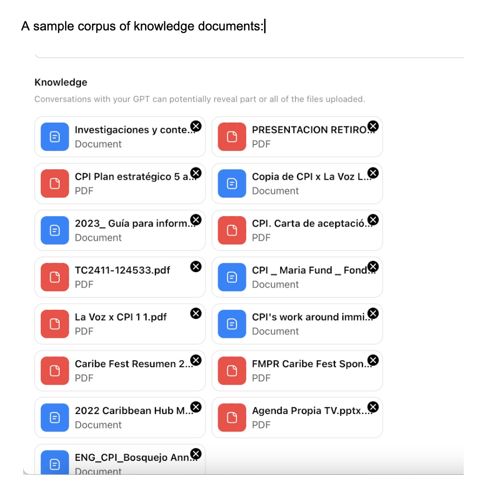

# Knowledge Files

This GPT requires you to compile and upload your own knowledge documents.

Compile a corpus of knowledge files that reflect your organization's mission and power your narrative. Examples include: strategic plan, mission statement, past grant applications, impact statements, and partnership pitches.

For example, CPI's knowledge files included the following:

## Setup

1. Select your corpus of knowledge files.
2. Upload those files to your GPT in the Knowledge section
3. The GPT will use them as context for responses
